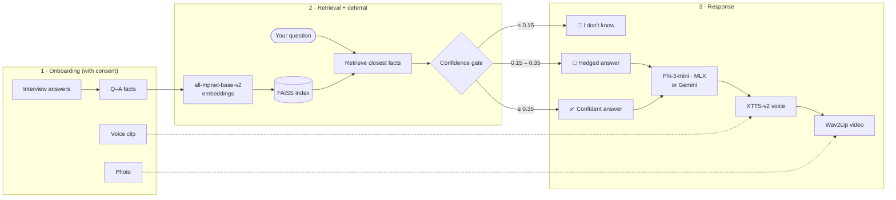

<div align="center">

# 🪞 Deferral Twin

### An honest digital twin. It answers in your words, voice and face, and says *"I don't know"* when it isn't sure.

[](https://github.com/saihardhikreddy/deferral-twin/actions/workflows/tests.yml)
[](#-quickstart)
[](requirements.txt)
[](src/llm_backend.py)
[](#-privacy--consent)
[](src/rag_pipeline.py)


**[Why it exists](#-why-deferral)** · **[Features](#-features)** · **[How it works](#-how-it-works)** · **[Results](#-results)** · **[Quickstart](#-quickstart)** · **[Docs](#-documentation)**

</div>

---

## 💡 Why deferral?

Most "digital twins" make things up. Ask one something its owner never talked about and it will still answer, confidently, in their name.

**Deferral Twin doesn't.** Every answer is grounded in what the person actually said. A confidence gate measures how close the question is to that evidence, and when nothing is close enough, the twin says it doesn't know. **An honest "I don't know" beats a confident fabrication.**

The whole thing runs **on one 16 GB Apple Silicon Mac, fully offline** after setup, packaged as a native app (`DeferralTwin.app`).

---

## ✨ Features

<table>
<tr>
<td width="50%" valign="top">

### 🧠 Answers as you
Retrieves your closest interview answers using sentence embeddings and FAISS, then writes a reply grounded in them with **Phi-3-mini (4-bit, Apple MLX)**.

### 🚦 Defers when unsure
A three-tier confidence gate decides whether to **refuse**, **hedge** or **answer**. This is the core idea of the project.

### 📚 Learns without fine-tuning
Corrections and notes go into memory and take effect immediately. No retraining.

### 🔍 Shows its evidence
The *"Why this answer"* view lists the exact facts and similarity scores behind every reply.

</td>
<td width="50%" valign="top">

### 🗣️ Speaks in your voice
**XTTS-v2** clones the voice from a short clip. **Whisper** powers hands-free *Talk mode*.

### 🎭 Appears as you
**Wav2Lip** lip-syncs your photo (optional **GFPGAN** sharpening). A **LivePortrait** character follows your cursor.

### 🌐 Multilingual and online-optional
English, **Telugu** and **Hindi**. An optional *Online mode* uses Google Gemini with model fallback.

### 🎲 Extras
Expert mode for your field · chat memory for follow-ups · *"Guess me"* game · *"What would I do?"* decisions · Big Five personality snapshot.

</td>
</tr>
</table>

---

## ⚙️ How it works



### The confidence gate

| Similarity to best evidence | Tier | What the twin does |
|:---:|:---:|---|
| **< 0.15** | 🙅 Refuse | Says *"I don't know"*. Nothing it knows is close enough. |
| **0.15 – 0.35** | 🤔 Soft | Gives a grounded answer, clearly hedged. |
| **≥ 0.35** | ✅ Confident | Answers normally, grounded in the retrieved facts. |

Both thresholds are tunable in [`configs/config.yaml`](configs/config.yaml) (`deferral_hard_floor`, `deferral_similarity_threshold`). The logic lives in [`src/deferral.py`](src/deferral.py).

---

## 📊 Results

| Evaluation | Setting | Result |
|---|---|---|
| **Phase 1** | 100 people from Twin-2K-500 (Toubia et al., 2025), RAG + prompting | **0.268** cosine similarity vs. human retest ceiling of 0.887 |
| **Phase 2** | One consenting person, 18 held-out questions | **25.9% → 56.9%** of the person's own consistency ceiling after the answer-quality upgrade |

<div align="center">
<table>
<tr>
<td align="center"><br><sub><b>Risk–coverage</b> (100 people, 9,564 questions): the 0.35 cutoff answers 80% of questions at 0.373 mean similarity</sub></td>
<td align="center"><br><sub><b>Feedback loop</b> (9 people, 95% CI): similarity jumps from 0.35 to ~0.56 after 5 corrections; a control using another person's answers rises almost as much</sub></td>
</tr>
</table>
</div>

### ⚡ Speed on an M3 MacBook (16 GB)

| Stage | Time | Peak memory |
|---|---|---|
| Text answer (warm) | **~1.0 s** | 1.3 GB RAM + 2.2 GB Metal |
| Model load (cold start) | 3.4 s | |
| Voice (XTTS-v2, CPU) | **0.9 s per second of speech** | 3.2 GB |
| Lip-sync video (Wav2Lip) | **0.86 s per second of speech** | 4.0 GB |
| Video + GFPGAN sharpening | 65 s per second of speech (opt-in) | 4.2 GB |

Text never waits for voice or video. Full numbers and methodology are in [`BENCHMARK.md`](BENCHMARK.md).

---

## 🖼️ Screenshots

<div align="center">
<table>
<tr>
<td align="center"><br><sub>Welcome & consent</sub></td>
<td align="center"><br><sub>Landing</sub></td>
<td align="center"><br><sub>Character follows the cursor</sub></td>
</tr>
</table>
</div>

---

## 🚀 Quickstart

### Requirements
- Apple Silicon Mac (M1 or later) with **16 GB** memory
- **macOS 14** or later
- About **10 GB** free disk space for models (downloaded on first launch)

### Build and launch the app

```bash
git clone https://github.com/saihardhikreddy/deferral-twin.git
cd deferral-twin
./packaging/build_app.sh        # builds dist/DeferralTwin.app and dist/DeferralTwin.dmg
open dist/DeferralTwin.app      # first launch downloads models and sets itself up
```

First launch checks the machine, downloads model weights (resumable), builds three isolated Python environments and runs a self-test. See [`bootstrap/manifest.json`](bootstrap/manifest.json).

### Development mode

```bash
./run.sh                        # same app, opened in your browser
```

### UI-only mode (any OS, no models)

For working on the screens without downloading anything:

```bash
pip install -r requirements.txt fastapi "uvicorn[standard]" python-multipart opencv-python-headless
PYTHONHASHSEED=0 python scripts/dev_server.py --port 8000
```

### Tests

```bash
PYTHONHASHSEED=0 python tests/test_app.py
```

The other suites in [`tests/`](tests/) cover the gate, media, online mode, features and setup. `ffmpeg` must be on your `PATH`.

---

## 🗂️ Project structure

```
deferral-twin/
├── app/            FastAPI server + desktop window UI (app/static/)
├── src/            The twin: data loading, RAG, deferral gate, persona,
│                   LLM backends, voice & avatar, evaluation scripts
├── bootstrap/      First-run setup: machine check, resumable downloads,
│                   Python environments, self-test
├── packaging/      Builds DeferralTwin.app and the .dmg
├── configs/        config.yaml (gate thresholds, models, paths)
├── tests/          API, gate, media, online, feature and setup tests
├── notebooks/      Original Colab notebooks (Phase 1 + demo)
├── tools/          LivePortrait character tooling
└── docs/           Figures and the complete project guide (PDF)
```

---

## 📖 Documentation

| Document | What's inside |
|---|---|
| [`QUICKSTART.md`](QUICKSTART.md) | Shortest path to a running twin |
| [`HANDOFF.md`](HANDOFF.md) | Design brief and decisions |
| [`DESKTOP.md`](DESKTOP.md) | Desktop app architecture |
| [`BENCHMARK.md`](BENCHMARK.md) | Measured speed and memory |
| [`MAC_RUN_REPORT.md`](MAC_RUN_REPORT.md) | Build and fix log |
| [`docs/Deferral_Twin_Complete_Guide.pdf`](docs/Deferral_Twin_Complete_Guide.pdf) | The full project guide |

---

## 🔒 Privacy & consent

- **Local by default.** Everything stays on your Mac unless you turn on Online mode.
- **Consent-gated likeness.** Voice cloning and the talking face only work for the person who consented in the app.
- **Anonymous benchmarks.** Twin-2K-500 participants are never given a voice or a face.

---

## 🛣️ Roadmap

- [x] macOS app: complete
- [ ] Windows version (llama.cpp instead of MLX, [`bootstrap/manifest-windows.json`](bootstrap/manifest-windows.json)): in progress, not yet tested on Windows

---

## 👥 Team

**AI & ML Final Review, Team 8**

| Name | Roll number |
|---|---|
| **C Sai Hardhik** | CB.AI.U4AID25112 |
| **Gagan Chowdary** | CB.AI.U4AID25145 |
| **Charan Saatvikh** | CB.AI.U4AID25124 |

<div align="center">
<sub>Built with Phi-3 · MLX · FAISS · Sentence-Transformers · XTTS-v2 · Whisper · Wav2Lip · GFPGAN · LivePortrait · FastAPI</sub>
</div>
